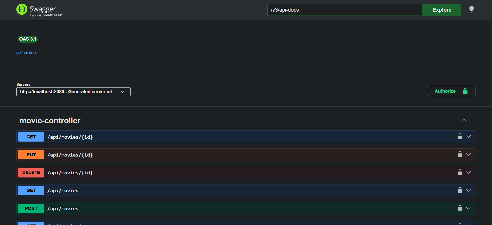

# Movie Journal API

A REST API where users keep a private journal of the movies they've watched, with ratings, reviews, pagination and personal statistics.

[](https://github.com/RaresPituru/movie-journal-api/actions/workflows/ci.yml)



---

## Features

- **JWT authentication.** Register and log in, then call the API with `Authorization: Bearer <token>`. The API is stateless and keeps no server-side sessions. Passwords are hashed with **BCrypt**.
- **Per-user data isolation.** Every SQL query is scoped to the authenticated user. Another user's movie returns **404**, so the API never reveals that it exists. The owner and the IDs are never taken from the request body.
- **Movie CRUD** with Bean Validation (rating 1–10, release year 1888–2100, length limits).
- **Pagination, sorting and filtering.** `page`, `size` (max 50), `sort` (`title` | `rating` | `releaseYear`), `direction`, `minRating`. Sort fields go through a whitelist and are never concatenated into SQL.
- **Statistics.** Total movies, average rating and highest-rated movie, all computed with SQL aggregation.
- **Consistent errors.** Every error, including 401/403 raised by Spring Security, uses the same JSON format.
- **Tests.** Unit tests plus integration tests against a real PostgreSQL started by Testcontainers. They run in GitHub Actions CI.
- **Docker.** Multi-stage `Dockerfile` and `docker-compose.yml` (app + PostgreSQL). Secrets come from a `.env` file.

## Tech stack

| Area | Technology |
|---|---|
| Language / framework | Java 21, Spring Boot 4 (Spring MVC, Spring Security) |
| Data access | **Spring `JdbcClient` with hand-written SQL** (no JPA/Hibernate) |
| Database | PostgreSQL 15; schema in [`schema.sql`](src/main/resources/schema.sql) |
| Auth | JWT (jjwt, HMAC-SHA256), BCrypt |
| Validation | Jakarta Bean Validation |
| API docs | springdoc-openapi / Swagger UI |
| Tests | JUnit 5, Mockito, AssertJ, MockMvc, Testcontainers |
| Build / CI / runtime | Maven Wrapper, GitHub Actions, Docker & Docker Compose |

## Architecture

The code is organised **package by feature**. Inside each feature it follows the usual layers: Controller → Service → Repository.

```
com.example.moviejournal
├── movie/       MovieController → MovieService → MovieRepository (JdbcClient + SQL)
│                Movie (internal model), MovieRequest / MovieResponse / PageResponse /
│                MovieStatsResponse (DTOs), MovieNotFoundException
├── user/        AuthController → UserService → UserRepository
│                User (internal model), RegisterRequest / LoginRequest / AuthResponse /
│                UserResponse (DTOs), UsernameAlreadyExistsException
├── security/    SecurityConfig (filter chain, BCrypt), JwtService (create/verify tokens),
│                JwtAuthenticationFilter, AuthenticatedUser (principal), OpenApiConfig
└── exception/   GlobalExceptionHandler + ApiError (the single error format)
```

- **Controllers** only handle HTTP. They validate input with `@Valid` and read the current user with `@AuthenticationPrincipal`.
- **Services** contain the business rules: ownership, "not found", duplicate usernames, and mapping between DTOs and internal models. Controllers never expose the internal models.
- **Repositories** contain the SQL. Every movie query includes `WHERE user_id = :userId`.
- **Request flow:** `JwtAuthenticationFilter` verifies the token and puts an `AuthenticatedUser(id, username)` into the `SecurityContext`. Requests without a valid token get a 401 before they reach a controller.

## Running the app

Requirements: [Docker](https://www.docker.com/products/docker-desktop/) with Docker Compose.

```bash
git clone https://github.com/RaresPituru/movie-journal-api.git
cd movie-journal-api
cp .env.example .env          # then edit the values; generate a JWT secret with: openssl rand -base64 48
docker compose up --build
```

- API: <http://localhost:8080>
- Swagger UI: <http://localhost:8080/swagger-ui.html>. Call `POST /api/auth/login`, click **Authorize**, and paste the token.

The app waits for PostgreSQL to pass its health check, then creates the tables from `schema.sql`.

> `schema.sql` uses `CREATE TABLE IF NOT EXISTS`, so it never changes existing tables. If you change the schema, reset the local database with `docker compose down -v` (this **deletes** the local data).

**Running without Docker for the app** (for example, from the IDE): start only the database with `docker compose up -d postgres-db`. Then export the variables from `.env` (`DB_USERNAME`, `DB_PASSWORD`, `JWT_SECRET`) and run `./mvnw spring-boot:run`.

### Quick try with curl

```bash
curl -X POST localhost:8080/api/auth/register -H 'Content-Type: application/json' \
     -d '{"username":"alice","password":"password123"}'

TOKEN=$(curl -s -X POST localhost:8080/api/auth/login -H 'Content-Type: application/json' \
     -d '{"username":"alice","password":"password123"}' | sed -E 's/.*"token":"([^"]+)".*/\1/')

curl -X POST localhost:8080/api/movies -H "Authorization: Bearer $TOKEN" -H 'Content-Type: application/json' \
     -d '{"title":"Inception","rating":9,"review":"Mind-bending","releaseYear":2010}'

curl "localhost:8080/api/movies?sort=rating&direction=desc&minRating=7" -H "Authorization: Bearer $TOKEN"
curl localhost:8080/api/movies/stats -H "Authorization: Bearer $TOKEN"
```

## Running the tests

```bash
./mvnw verify
```

This runs the unit tests and the integration tests. **Docker must be running**, because the integration tests start a PostgreSQL container with Testcontainers. You don't need a `.env` file or a local database. CI runs the same command on every push and pull request ([`.github/workflows/ci.yml`](.github/workflows/ci.yml)).

## API endpoints

All `/api/movies` endpoints require `Authorization: Bearer <token>` and only ever see the caller's own movies.

| Method | Path | Description | Success | Errors |
|---|---|---|---|---|
| POST | `/api/auth/register` | Create an account `{username, password}` | 201 `{id, username}` | 400, 409 |
| POST | `/api/auth/login` | Log in, returns `{token}` | 200 | 400, 401 |
| GET | `/api/movies` | List movies (paginated, see below) | 200 | 400, 401 |
| POST | `/api/movies` | Create a movie `{title, rating, review, releaseYear}` | 201 | 400, 401 |
| GET | `/api/movies/{id}` | Get one movie | 200 | 401, 404 |
| PUT | `/api/movies/{id}` | Replace a movie | 200 | 400, 401, 404 |
| DELETE | `/api/movies/{id}` | Delete a movie | 204 | 401, 404 |
| GET | `/api/movies/stats` | `{totalMovies, averageRating, highestRatedMovie}` | 200 | 401 |

**Query parameters for `GET /api/movies`:**

| Parameter | Default | Allowed values |
|---|---|---|
| `page` | `0` | ≥ 0 |
| `size` | `10` | 1–50 |
| `sort` | `title` | `title`, `rating`, `releaseYear` |
| `direction` | `asc` | `asc`, `desc` |
| `minRating` | none | 1–10 |

The response is `{content, page, size, totalElements, totalPages}`.

**Error format.** Every error uses this format; `fieldErrors` is empty unless validation failed:

```json
{
  "timestamp": "2026-11-21T22:45:38.619Z",
  "status": 400,
  "error": "Bad Request",
  "message": "Validation failed",
  "path": "/api/movies",
  "fieldErrors": [
    { "field": "rating", "message": "must be less than or equal to 10" }
  ]
}
```

## Next steps

- **Database migrations with Flyway**, instead of `schema.sql` with `IF NOT EXISTS`, so schema changes are versioned and applied to existing databases.
- **Refresh tokens and logout.** Use short-lived access tokens plus revocable refresh tokens, because a JWT currently stays valid until it expires.
- **Rate limiting on `/api/auth/login`** to slow down brute-force password guessing.
